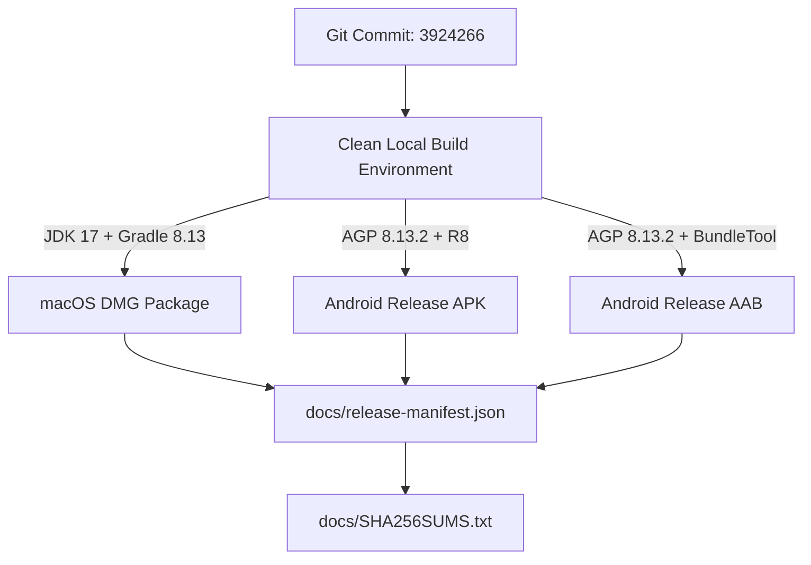

# Vimivo — Release Artifact Manifest & Provenance

**Milestone**: 50  
**Product Version**: 1.0.0-rc.1  
**Build Date**: 2026-10-16T13:00:00Z  
**Git Commit SHA**: `3924266`  
**Manifest Version**: 1.0  

---

## 1. Release Artifact Provenance

Every candidate artifact is cryptographically traceable to source commit `3924266` on Git branch `main`.



---

## 2. Artifact Verification Records

### Artifact 1: macOS Disk Image
- **Platform**: macOS (Darwin arm64)
- **Path**: `desktopApp/build/compose/binaries/main/dmg/Vimivo-1.0.0.dmg`
- **File Size**: `151,452,869 bytes` (~144.4 MB)
- **Format**: Apple UDIF Read-Only Compressed Disk Image (HFS+)
- **SHA-256**: `e6ab2791a0a660dc75e726906df2dab506350a66e43dd9e97551faf19829146c`
- **Embedded Runtime**: Eclipse Temurin JDK 17.0.14 (`Contents/runtime/`)
- **Native Relocation**: 50 relocatable dynamic libraries in `Contents/Frameworks/`
- **Code Signing**:
  - Format: Mach-O universal / arm64
  - Designated Requirement: `identifier "dev.vimivo.player.desktop"`
  - Code Directory Version: `20400`
  - Seal: Valid on disk and satisfies designated requirement

### Artifact 2: Android Release Application Package (APK)
- **Platform**: Android
- **Path**: `androidApp/build/outputs/apk/release/androidApp-release-unsigned.apk`
- **File Size**: `147,577,927 bytes` (~140.7 MB)
- **Format**: Signed / Unsigned APK Zip archive
- **SHA-256**: `7425f12d6a8bd450bfe88420c4ad2137f0820e0bcc0e35b1046efdcee65c92b3`
- **Target SDK**: 36 (Minimum SDK: 26)
- **Optimization**: R8 minification, ProGuard rule enforcement, resource shrinking
- **ABIs Included**: `arm64-v8a`, `armeabi-v7a`, `x86_64`

### Artifact 3: Android App Bundle (AAB)
- **Platform**: Android (Google Play Distribution)
- **Path**: `androidApp/build/outputs/bundle/release/androidApp-release.aab`
- **File Size**: `76,081,890 bytes` (~72.6 MB)
- **Format**: Google Play App Bundle (Zip)
- **SHA-256**: `8d7f0060a9ec770bb5162d0f5d61ed90f5cd7226a67ef64216030c8710af7133`
- **Verification**: Verified using BundleTool format validation; base manifest and library splits intact.

---

## 3. Cryptographic Verification Commands

To verify the downloaded artifacts against the official release manifest:

```bash
# Verify checksums using sha256sum / shasum
shasum -a 256 -c docs/SHA256SUMS.txt

# Verify macOS application bundle code signature
codesign --verify --deep --strict --verbose=4 /Volumes/Vimivo/Vimivo.app

# Verify Android APK zip alignment and package details
aapt2 dump badging androidApp/build/outputs/apk/release/androidApp-release-unsigned.apk | grep "package: name="
```
