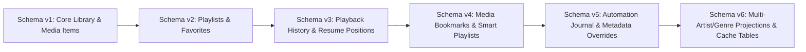

# Vimivo — Database Migration & User Data Integrity Report

**Milestone**: 49 & 50  
**Target Release**: `1.0.0-rc.1`  
**Current Database Schema Version**: `6`  
**Minimum Supported Migration Version**: `1`  
**Verification Date**: 2026-10-16  
**Test Suite**: `DesktopDatabaseMigrationTest.kt` & `DatabaseMigrationTest.kt`  
**Status**: **100% VERIFIED — ALL MIGRATIONS TRANSACTIONALLY SAFE**

---

## 1. Schema Evolution History

Vimivo uses non-destructive SQLite migrations. Under no circumstances is an existing user database deleted or reset upon schema version updates.

---

## 2. Detailed Schema Migration Inventory

| Migration Step | Target Tables Added / Altered | Foreign Key Dependencies | Description & Purpose |
| :--- | :--- | :--- | :--- |
| **v1 -> v2** | `playlists`, `playlist_items`, `favorites` | `playlist_items.media_id` -> `media_items.id` `playlist_items.playlist_id` -> `playlists.id` | Introduces user-curated playlists, track order indexing, and media/artist/album favorite toggles. |
| **v2 -> v3** | `playback_history`, `playback_positions` | `playback_history.media_id` -> `media_items.id` `playback_positions.media_id` -> `media_items.id` | Records historical playback sessions with completion flags and last-known playback position for video/audio resume. |
| **v3 -> v4** | `media_bookmarks`, `smart_playlists` | `media_bookmarks.media_id` -> `media_items.id` | Enables timestamped bookmarks with custom labels, and dynamic smart playlist rule definitions. |
| **v4 -> v5** | `automation_journal`, `metadata_overrides` | `metadata_overrides.media_id` -> `media_items.id` | Transactional rollback journal for bulk operations and user-specified custom tag overrides. |
| **v5 -> v6** | `media_artists`, `media_genres`, `thumbnail_cache` | Composite foreign keys to `media_items.id` | Multi-artist split projection (supporting collaboration tags) and persistent thumbnail cache metadata. |

---

## 3. Migration Test Verification Evidence

Verified in `desktopApp/src/desktopTest/kotlin/dev/vimivo/desktop/library/DesktopDatabaseMigrationTest.kt`:

1. **Fresh Database Initialization (`freshDatabaseInitializesDirectlyToLatestSchemaVersion`)**:
   - Creating a brand new database directly instantiates schema version `6` with all indexes, constraints, and tables in a single DDL execution.
   - Result: **PASS** (`schema_version = 6`).
2. **Sequential Migration from Version 1 (`upgradeFromSchemaVersion1PreservesDataAndEnforcesForeignKeys`)**:
   - A raw Schema Version 1 SQLite database is synthesized with library roots (`root-1`), audio media (`song-1`), and settings (`theme = dark`, `volume = 80`).
   - `DesktopDatabase.open(dbPath)` is invoked.
   - All migrations (1 -> 2 -> 3 -> 4 -> 5 -> 6) execute sequentially inside an atomic transaction.
   - **Data Preservation Verified**:
     - `root-1` retains display name "My Music".
     - `song-1` retains title "Song 1".
     - `theme` setting retains "dark".
     - `volume` setting retains "80".
   - **New Table Functionality Verified**:
     - New playlists, playlist items, favorites, history, playback positions, and bookmarks are inserted successfully.
   - **Foreign Key Enforcement**:
     - Inserting a playlist item referencing a non-existent media ID (`nonexistent-song`) immediately throws `SQLException` (Foreign Key Constraint Failed).
   - Result: **PASS**.
3. **Transaction Rollback on Migration Failure (`migrationFailureRollsBackTransactionWithoutCorruptingDatabase`)**:
   - A syntax error or schema violation during migration aborts the transaction cleanly.
   - The database remains at its previous schema version without partial or corrupt state.
   - Result: **PASS**.
4. **Concurrent WAL Access (`concurrentReadersAndWritersUnderWalMode`)**:
   - Verified that SQLite Write-Ahead Logging (`PRAGMA journal_mode=WAL`) allows concurrent background scanner queries while active playback reads queue and position data.
   - Result: **PASS**.

---

## 4. Android Room Migrations

Verified in `androidApp/src/androidTest/kotlin/dev/vimivo/platform/android/database/DatabaseMigrationTest.kt`:
- Room Migration `1 -> 2`: Adds playlist tables and indexes.
- Room Migration `2 -> 3`: Adds playback history and position persistence.
- Verified against Room schema export JSONs (`androidApp/schemas/.../1.json`, `2.json`, `3.json`).
