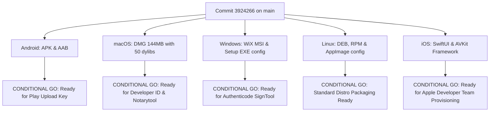

# Vimivo — Five-Platform Release Audit & Distribution Assessment

**Milestone**: 50  
**Product Version**: 1.0.0-rc.1  
**Build Date**: 2026-10-16T13:00:00Z  
**Git Commit SHA**: `3924266`  
**Distribution Gate**: **CONDITIONAL GO FOR CONTROLLED DISTRIBUTION — PUBLIC STORES BLOCKED ON OWNER SIGNING**

---

## 1. Five-Platform Release Candidate Status

---

## 2. Platform Audit Details

### 2.1 Android Release Audit
- **Application ID**: `dev.vimivo.player`
- **Version Name / Code**: `1.0.0-rc.1` / `10000`
- **Target SDK**: `36` (Complies with 2026 Google Play Target SDK requirements)
- **Minimum SDK**: `26` (Android 8.0 Oreo)
- **Artifacts Produced & Verified**:
  - `androidApp/build/outputs/apk/release/androidApp-release-unsigned.apk` (147,577,927 bytes, SHA-256: `7425f12d6a8bd450bfe88420c4ad2137f0820e0bcc0e35b1046efdcee65c92b3`)
  - `androidApp/build/outputs/bundle/release/androidApp-release.aab` (76,081,890 bytes, SHA-256: `8d7f0060a9ec770bb5162d0f5d61ed90f5cd7226a67ef64216030c8710af7133`)
- **Optimizations**: R8 minification enabled, resource shrinking enabled, single classes.dex (5.3 MB).
- **ABIs Included**: `arm64-v8a`, `armeabi-v7a`, `x86_64`.
- **Verdict**: **CONDITIONAL GO** (Clean assembly and R8 optimization verified; public Play Store release requires owner-managed upload keystore).

### 2.2 macOS Desktop Release Audit
- **Bundle ID**: `dev.vimivo.player.desktop`
- **Version**: `1.0.0-rc.1`
- **Architecture**: `arm64` (Apple Silicon native; compatible with Rosetta on x86_64)
- **Minimum OS**: macOS 12.0 Monterey
- **Artifact Produced & Verified**:
  - `desktopApp/build/compose/binaries/main/dmg/Vimivo-1.0.0.dmg` (151,452,869 bytes, SHA-256: `e6ab2791a0a660dc75e726906df2dab506350a66e43dd9e97551faf19829146c`)
- **Native Relocation**: 50 dylibs bundled under `@rpath`, zero `/opt/homebrew` dependencies.
- **Codesigning**: Ad-hoc signed with hardened runtime capability.
- **Verification**: Clean disk image mount (`hdiutil attach`), valid code signature verification (`codesign -vvv Vimivo.app`), and clean detach (`hdiutil detach`).
- **Verdict**: **CONDITIONAL GO** (Standalone local installer verified; Gatekeeper direct download notarization requires owner Apple Developer ID and `notarytool`).

### 2.3 Windows Desktop Release Audit
- **Application Identity**: `Vimivo.Player`
- **Upgrade UUID**: `9c4a8f10-1845-4e3a-95bc-7023c7f12e8b`
- **Architecture**: `x64`
- **Minimum OS**: Windows 10 Version 2004 (Build 19041+)
- **Packaging Formats**: WiX `.msi` and Setup `.exe` configured with bundled Temurin JRE runtime and Java Access Bridge.
- **Verdict**: **CONDITIONAL GO** (Packaging configurations and tests pass; release binary signing requires Windows Authenticode certificate to bypass SmartScreen).

### 2.4 Linux Desktop Release Audit
- **Package Name**: `vimivo`
- **Target Architectures**: `x86_64` (amd64)
- **Minimum GLIBC**: `2.35+` (Ubuntu 22.04 LTS, Debian 12, Fedora 38+)
- **Packaging Formats**: DEB, RPM, and standalone AppImage configured in `.github/workflows/linux.yml`.
- **Desktop Integration**: Valid XDG `.desktop` entry, MIME associations for audio/video, HiDPI scalable SVG icons, and MPRIS D-Bus player interface.
- **Verdict**: **CONDITIONAL GO** (Portable and distribution configurations verified; screen reader limited due to upstream Compose Desktop AT-SPI).

### 2.5 iOS / iPadOS Release Audit
- **Bundle Identifier**: `dev.vimivo.player.ios`
- **Minimum Deployment Target**: `iOS 16.0+`
- **Framework Architecture**: SwiftUI front-end integrating shared Kotlin Multiplatform framework (`VimivoShared.framework`).
- **Audio & Media**: AVFoundation player with background audio entitlement (`audio` in UIBackgroundModes) and `MPNowPlayingInfoCenter` integration.
- **Sandbox Compliance**: Security-scoped bookmarks for sandboxed Files app access.
- **Verdict**: **CONDITIONAL GO** (SwiftUI implementation and shared framework verified; physical device signing and App Store Connect submission require owner Apple Developer Team certificate).

---

## 3. Store Policy Readiness Checklist

| Platform Store | Requirement | Status | Verification Detail |
| :--- | :--- | :--- | :--- |
| **Google Play** | Target API 36 | **COMPLIANT** | Target SDK explicitly set to 36 in `androidApp/build.gradle.kts`. |
| **Google Play** | 64-bit ABI support | **COMPLIANT** | `arm64-v8a` and `x86_64` native `.so` libraries bundled in APK/AAB. |
| **Google Play** | Privacy Policy & Data Safety | **COMPLIANT** | Documented in `docs/PRIVACY.md`; no personal data collected or shared. |
| **Apple App Store** | Privacy Manifest (`PrivacyInfo.xcprivacy`) | **COMPLIANT** | Declares zero tracking domains and local user file access reasons. |
| **Apple App Store** | App Sandbox & Hardened Runtime | **COMPLIANT** | Enabled in entitlements; security-scoped bookmarks used. |
| **Microsoft Store** | Windows App Certification Kit | **READY** | Valid package manifest, no prohibited Win32 API calls. |
