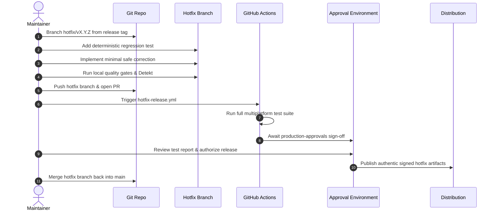

# Vimivo Emergency Hotfix & Patch Release Procedure

> [!IMPORTANT]
> This procedure establishes the rapid, verified protocol for issuing emergency patches without bypassing code quality, security signing, or maintainer approval.

---

## 1. Hotfix Triggers & Criteria

An emergency hotfix is authorized **only** when an issue qualifies as **P0 (Critical)** or **P1 (High)**:
- Crash upon application startup affecting supported platforms.
- Unhandled SQLite database migration error risking user data loss.
- High-severity security vulnerability in native multimedia decoders or network handling.
- Corrupted release package or broken installer preventing installation.

---

## 2. Step-by-Step Hotfix Execution Guide



### 2.1 Branch Creation
```bash
git checkout -b hotfix/v1.0.1 v1.0.0
```

### 2.2 Add Automated Regression Test
Before writing the code fix, write an automated test in `shared/src/commonTest` or `desktopApp/src/desktopTest` that reproduces the bug and fails without the fix.

### 2.3 Apply Minimal Code Correction
Implement the minimal safe fix. Do not include cosmetic changes, refactoring, or feature code in a hotfix.

### 2.4 Verify Quality Gates Locally
```bash
./gradlew :shared:desktopTest :desktopApp:desktopTest :desktopApp:compileKotlinDesktop :androidApp:testDebugUnitTest :androidApp:assembleDebug detekt
```

### 2.5 Trigger Protected CI Workflow
Trigger `.github/workflows/hotfix-release.yml` with:
- `hotfix_version`: Next patch SemVer (e.g., `1.0.1`)
- `security_advisory_id`: Incident ID (e.g., `VIMIVO-SEC-2026-001` or `NA`)
- `target_channel`: `stable`

### 2.6 Multi-Party Production Authorization
Release artifacts are held in the `production-approvals` GitHub environment until authorized maintainers review the test logs and approve deployment.

### 2.7 Back-Merge into Main
After the release is published, merge `hotfix/v1.0.1` back into `main` to ensure the fix is permanently preserved.
