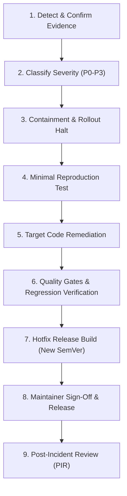

# Vimivo Incident Response & Recovery Runbook

> [!IMPORTANT]
> This runbook dictates the protocol for addressing critical reliability regressions, security vulnerabilities, corrupted database migrations, and software supply-chain emergencies.

---

## 1. Incident Severity Matrix

| Severity | Definition | Target Containment | Target Resolution |
| :--- | :--- | :--- | :--- |
| **P0 — Critical** | User data loss, database corruption, remote execution vulnerability, compromised signing key/update manifest. | < 4 hours | < 24 hours |
| **P1 — High** | Application fails on launch on supported OS, complete audio/video playback failure on standard media, broken installer. | < 12 hours | < 48 hours |
| **P2 — Medium** | Playback failure on specific edge container, non-fatal background audio interruption, UI crash in non-primary view. | < 48 hours | < 7 days |
| **P3 — Low** | Minor visual glitch, metadata formatting edge case, non-blocking cosmetic defect. | Next cycle | Next milestone |

---

## 2. Nine-Step Emergency Response Protocol

### Step 1: Evidence Confirmation
- Collect privacy-safe user diagnostic export or tester logs.
- Identify exact affected versions, platforms, and native multimedia dependencies.

### Step 2: Severity Classification
- Assign Incident Lead.
- Declare incident severity based on the Severity Matrix above.

### Step 3: Containment
- If distributed via staged rollout (Google Play / App Store), halt rollout immediately.
- If desktop update metadata is compromised, replace `release-manifest.json` with previous verified stable release metadata.

### Step 4: Deterministic Reproduction
- Create an automated reproduction test in `commonTest` or `desktopTest` reproducing the fault without flaky sleep delays.

### Step 5: Minimal Remediation
- Implement the minimal safe fix directly on a dedicated `hotfix/vX.Y.Z` branch branched from the affected release tag.
- Never include unrelated feature code in an emergency hotfix.

### Step 6: Full Verification Gates
- Execute `./gradlew detekt`.
- Run `:shared:desktopTest`, `:desktopApp:desktopTest`, and `:androidApp:testDebugUnitTest`.
- Run `:androidApp:assembleDebug` and `:desktopApp:compileKotlinDesktop`.

### Step 7: Hotfix Release Preparation
- Bump version to next patch version (e.g., `1.0.0` -> `1.0.1`).
- Generate new SHA-256 checksums for all release artifacts.

### Step 8: Multi-Party Authorization & Deployment
- Trigger `.github/workflows/hotfix-release.yml`.
- Await required maintainer approval in the `production-approvals` environment before releasing.

### Step 9: Post-Incident Review
- Document root cause, timeline, detection gap, and preventative architecture changes in `docs/INCIDENT_RESPONSE.md`.
