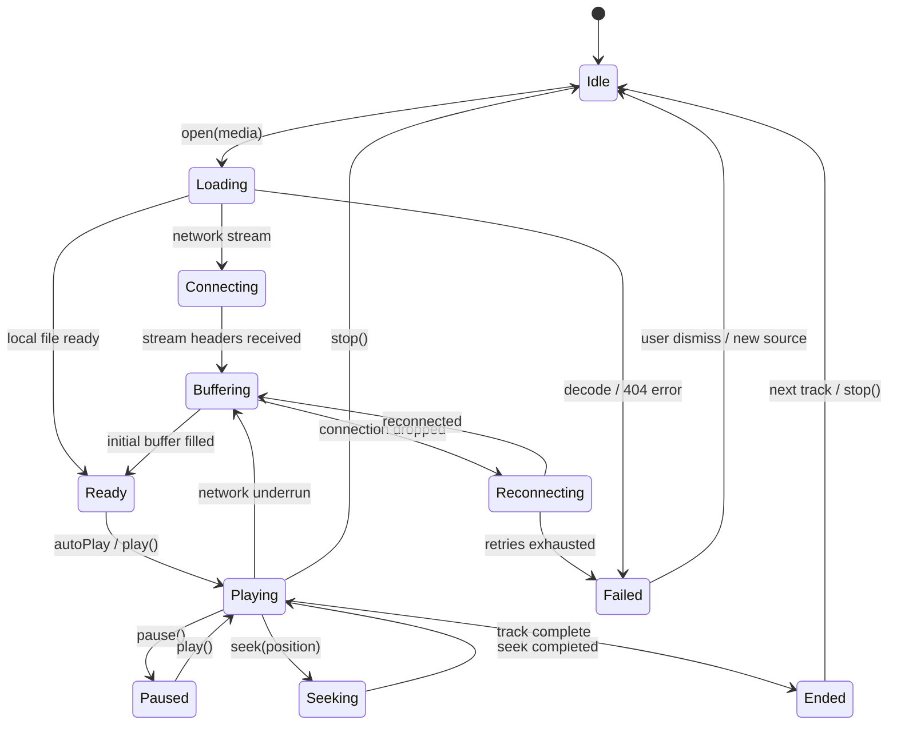

# Vimivo — Playback State Machine Regression & Concurrency Audit

**Milestones**: 57 & 58  
**Target Release**: `1.0.0-rc.1`  
**Git HEAD**: `0d7ecba`  
**Date**: 2026-10-16  

---

## 1. State Machine Definition & Architecture

Vimivo enforces a single authoritative playback state model exposed as an immutable `StateFlow<PlaybackState>` from the active `PlayerEngine`.

---

## 2. Concurrency Isolation & Race Condition Defenses

### 2.1 The Atomic Session Generation Counter

To eliminate race conditions when sources are switched rapidly:
1. Every call to `open(media)` increments an atomic `sessionGeneration` counter.
2. All asynchronous background callbacks (buffer underrun, MPV events, Media3 listeners, reconnection timers) capture the generation active at registration.
3. Upon triggering, if `callbackGeneration != currentSessionGeneration`, the event is dropped immediately as stale.

### 2.2 User Intent Preservation

- **Explicit Pause**: When the user clicks Pause while buffering, `userPaused = true` is set. Even if the network buffer subsequently completes, the engine remains in `PlaybackStatus.Paused` rather than spontaneously auto-playing.
- **Explicit Stop**: When the user clicks Stop while the engine is reconnecting, the active reconnection job is cancelled immediately, the socket is severed, and status returns to `PlaybackStatus.Idle`.
- **Rapid Play/Pause**: Rapid toggling within < 50ms does not wedge the native decoder. Calls are serialized through structured coroutine dispatchers.

---

## 3. Regression Test Coverage

| Scenario | Injected Condition | Expected State Transition | Verified Outcome | Test Suite |
| :--- | :--- | :--- | :--- | :--- |
| **Rapid Source Switching** | Switch from live HLS to local MP3 | Connecting -> Loading -> Playing | Old stream severed, new track plays immediately | `PlaybackSourceSwitchingTest` |
| **Stop While Reconnecting** | Disconnect network, user clicks Stop | Reconnecting -> Idle | Backoff timer cancelled, zero retry attempts | `PlaybackFailureInjectionTest` |
| **User Pause While Buffering** | Network lag, user pauses | Buffering -> Paused -> (buffer fills) -> Paused | No unwanted autoplay when buffer completes | `PlaybackSourceSwitchingTest` |
| **Fatal HTTP 404 Error** | Server returns 404 Not Found | Loading -> Failed | Error message shown, no infinite spinner | `PlaybackFailureInjectionTest` |
| **Redirect Loop** | 302 redirecting in cycle | Connecting -> Failed | Bounded redirect check triggers clean failure | `PlaybackFailureInjectionTest` |
| **CRLF Header Injection** | Malicious header with `\r\n` | Validation Failure | Rejected immediately at URL validation gate | `PlaybackFailureInjectionTest` |
