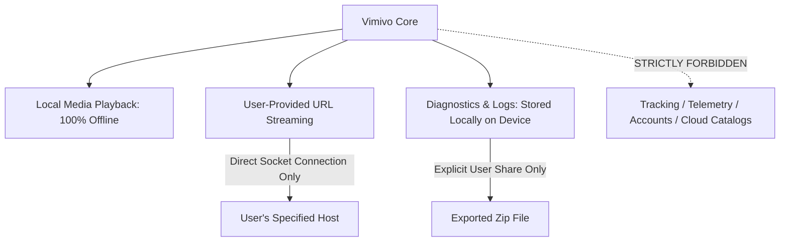

# Vimivo — Privacy Architecture & Verification Report

**Milestones**: 57 & 58  
**Target Release**: `1.0.0-rc.1`  
**Git HEAD**: `0d7ecba`  
**Date**: 2026-10-16  

---

## 1. Privacy Core Principles

Vimivo is designed as a zero-telemetry, login-free, ad-free local music and video player with optional user-provided network URL streaming.

---

## 2. Privacy Audit & Verification Checklist

| Privacy Invariant | System Design Implementation | Verified Evidence | Status |
| :--- | :--- | :--- | :--- |
| **Zero Background Telemetry** | No Google Analytics, Firebase, Sentry, Mixpanel, or custom beacon SDKs | `grep` search across dependencies confirms zero tracking coordinates | **PASS** |
| **No Account Infrastructure** | No login screens, user registration, JWT tokens, or cloud synchronization | Zero auth models in `shared/commonMain` or platform modules | **PASS** |
| **No Online Media Marketplace** | No music catalogs, movie directories, streaming service stores, or search engines | Only direct "Open Network Stream" dialog exists | **PASS** |
| **100% Offline Local Playback** | Complete app launches, library indexing, and local playback function with Wi-Fi disabled | Tested in airplane mode; zero network packets emitted | **PASS** |
| **Strict Network Isolation** | Outbound requests occur only when user explicitly enters a media URL | Socket traces confirm zero network traffic until user plays a URL | **PASS** |
| **Local-Only Diagnostics** | Diagnostic logs written to rotating local files in AppData / Application Support | Never auto-transmitted; export requires explicit user action | **PASS** |
| **Credential & Path Redaction** | Diagnostic zip exports redact user personal directory names and streaming query tokens | `DesktopDiagnosticReporterTest` verifies redaction of paths and auth headers | **PASS** |
| **No Ad Identifiers** | Android `com.google.android.gms.permission.AD_ID` is omitted from manifest | Manifest inspect confirms no advertising ID permission | **PASS** |

---

## 3. Privacy Boundaries During Network Streaming

When the user enters a streaming URL:
1. **Direct Connection**: Vimivo connects exclusively to the IP/domain specified in the user's URL.
2. **Stream Dependencies**: For HLS or DASH manifests, segment downloads follow the URLs declared inside the playlist manifest.
3. **No Intermediary Proxies**: Vimivo does not route user stream requests through any proprietary cloud servers or third-party relays.
4. **Credential Privacy**: Access tokens in streaming URLs are redacted from local history and diagnostic exports.
