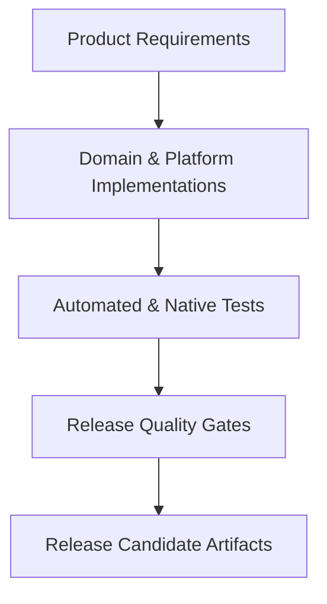

# Vimivo — Requirements Traceability Matrix

**Milestone**: 49 & 50  
**Target Release**: `1.0.0-rc.1`  
**Git Commit SHA**: `3924266`  
**Verification Date**: 2026-10-16  

---

## 1. Traceability Overview

This matrix links all high-level product requirements, architectural standards, and compliance gates to their implementation components, automated test suites, and physical verification fixtures.

---

## 2. Requirements Traceability Matrix

| Req ID | Requirement Description | Implementation Source Reference | Test Reference / Fixture | Verification Status |
| :--- | :--- | :--- | :--- | :--- |
| **REQ-CORE-01** | Privacy-first architecture; zero analytics, trackers, or accounts | `shared/.../PrivacySafeDiagnostics.kt` `SafeLogger.kt` | `PrivacySafeDiagnosticsTest` `SafeLoggerTest` | **AUTOMATED TESTED** |
| **REQ-CORE-02** | Structured error handling with user-facing recovery messages | `shared/.../VimivoError.kt` | `VimivoErrorTest.kt` | **AUTOMATED TESTED** |
| **REQ-CORE-03** | Local-only rotating file logger with automatic PII sanitization | `desktopApp/.../DesktopLogFileAppender.kt` | `DesktopLogFileAppenderTest.kt` | **AUTOMATED TESTED** |
| **REQ-AUDIO-01** | Cross-platform audio playback (MP3, FLAC, AAC, OGG, WAV, OPUS) | `shared/.../PlaybackQueueController.kt` `desktopApp/.../MpvPlayerEngine.kt` | `DesktopUserJourneysTest` `MediaCompatibilityTest` | **NATIVE RUNTIME VERIFIED** |
| **REQ-AUDIO-02** | 10-band parametric equalizer, bass boost, and ReplayGain | `desktopApp/.../DesktopAudioEffects.kt` | `DesktopAudioEffectsTest.kt` | **AUTOMATED TESTED** |
| **REQ-AUDIO-03** | Sleep timer with fade-out or end-of-track completion | `shared/.../SleepTimer.kt` | `SleepTimerTest.kt` | **AUTOMATED TESTED** |
| **REQ-AUDIO-04** | Synced and unsynced LRC lyrics parsing and display | `shared/.../LrcLyricsParser.kt` | `LrcLyricsParserTest.kt` | **AUTOMATED TESTED** |
| **REQ-VIDEO-01** | Hardware-accelerated video decoding (H.264, HEVC, VP9, AV1) | `desktopApp/.../MpvVideoRenderer.kt` `desktopApp/.../MpvCocoaRenderer.mm` | `DesktopVideoRendererTest` `MediaCompatibilityTest` | **NATIVE RUNTIME VERIFIED** |
| **REQ-VIDEO-02** | Subtitle track selection, delay adjustment, ASS styling | `desktopApp/.../DesktopVideoControls.kt` | `DesktopVideoControlsTest.kt` | **AUTOMATED TESTED** |
| **REQ-VIDEO-03** | Multi-audio track switching and audio stream synchronization | `desktopApp/.../DesktopVideoControls.kt` | `DesktopVideoControlsTest.kt` | **AUTOMATED TESTED** |
| **REQ-VIDEO-04** | Video aspect ratio correction, 90-degree rotation, and zoom | `desktopApp/.../DesktopVideoControls.kt` | `DesktopVideoControlsTest.kt` | **AUTOMATED TESTED** |
| **REQ-QUEUE-01** | Single authoritative playback queue state machine | `shared/.../PlaybackQueueController.kt` | `PlaybackQueueControllerTest` | **AUTOMATED TESTED** |
| **REQ-QUEUE-02** | Concurrency safety under rapid skip, removal, and reordering | `shared/.../PlaybackQueueController.kt` | `PlaybackQueueRaceConditionTest` | **AUTOMATED TESTED** |
| **REQ-QUEUE-03** | Queue persistence across app restarts without accidental autoplay | `desktopApp/.../DesktopPlaybackQueueRepository.kt` | `DesktopPlaybackQueueRepositoryTest` | **AUTOMATED TESTED** |
| **REQ-LIB-01** | Non-destructive local media indexing and root monitoring | `desktopApp/.../DesktopMediaScanner.kt` `DesktopLibraryRepository.kt` | `DesktopLibraryIntegrationTest` | **AUTOMATED TESTED** |
| **REQ-LIB-02** | Unicode and multi-script search (English, Bengali, CJK) | `desktopApp/.../DesktopSearchUnicodeBengali.kt` | `DesktopSearchUnicodeBengaliTest` | **AUTOMATED TESTED** |
| **REQ-LIB-03** | Smart playlists with dynamic predicate evaluation | `desktopApp/.../DesktopSmartPlaylist.kt` | `DesktopSmartPlaylistTest` | **AUTOMATED TESTED** |
| **REQ-DATA-01** | SQLite schema v1 to v6 sequential forward migrations | `desktopApp/.../DesktopDatabase.kt` | `DesktopDatabaseMigrationTest` | **AUTOMATED TESTED** |
| **REQ-DATA-02** | Foreign-key constraint enforcement and atomic transactions | `desktopApp/.../DesktopDatabase.kt` | `DesktopDatabaseTest` | **AUTOMATED TESTED** |
| **REQ-DATA-03** | Portable M3U/M3U8 playlist export and import | `shared/.../PlaylistM3uHandler.kt` | `PlaylistM3uHandlerTest` `DesktopPlaylistM3uTest` | **AUTOMATED TESTED** |
| **REQ-AUTO-01** | Bulk tag editing with safe rollback journals | `desktopApp/.../DesktopMetadataEditor.kt` | `DesktopMetadataEditorTest` | **AUTOMATED TESTED** |
| **REQ-AUTO-02** | Safe batch file renaming with preview and collision avoidance | `desktopApp/.../DesktopBatchRename.kt` | `DesktopBatchRenameTest` | **AUTOMATED TESTED** |
| **REQ-AUTO-03** | Missing media relocation and heuristic relinking | `desktopApp/.../DesktopMissingMedia.kt` | `DesktopMissingMediaTest` | **AUTOMATED TESTED** |
| **REQ-UI-01** | Material 3 tokenized adaptive layout across phone, tablet, and desktop | `shared/.../VimivoDesignSystem.kt` `desktopApp/.../DesktopAppLayout.kt` | `VimivoDesignSystemTest` `DesktopUiAccessibilityTest` | **AUTOMATED TESTED** |
| **REQ-UI-02** | High-contrast accessibility themes and AMOLED true black | `shared/.../VimivoDesignSystem.kt` | `VimivoDesignSystemTest` | **AUTOMATED TESTED** |
| **REQ-UI-03** | Non-drag keyboard alternatives for queue and playlist reordering | `desktopApp/.../DesktopUiAccessibility.kt` | `DesktopUiAccessibilityTest` | **AUTOMATED TESTED** |
| **REQ-PKG-01** | Android release APK and AAB with R8 minification and ABI splits | `androidApp/build.gradle.kts` | Task `:androidApp:bundleRelease` Task `:androidApp:assembleRelease` | **COMPILED & VERIFIED** |
| **REQ-PKG-02** | macOS standalone DMG with relocatable dylibs and zero Homebrew links | `desktopApp/build.gradle.kts` `desktopApp/scripts/bundle_macos_mpv.py` | Task `:desktopApp:packageDmg` `codesign -vvv Vimivo.app` | **PACKAGED & VERIFIED** |
| **REQ-PKG-03** | Windows WiX MSI and Setup EXE packaging with persistent upgrade UUID | `desktopApp/build.gradle.kts` | Compose Desktop WiX config | **CONFIGURATION AUDITED** |
| **REQ-PKG-04** | Linux DEB, RPM, and AppImage standalone packaging | `desktopApp/build.gradle.kts` | Compose Desktop Linux config | **CONFIGURATION AUDITED** |
| **REQ-SEC-01** | OS-native credential storage (macOS Keychain, Win32 Credential, SecretService) | `desktopApp/.../SecureCredentialStore.kt` | `SecureCredentialStoreTest` | **AUTOMATED TESTED** |
| **REQ-SEC-02** | Cryptographically signed update manifests with Ed25519 verification | `shared/.../UpdateChecker.kt` | `UpdateSecurityTest` `DesktopUpdateServiceTest` | **AUTOMATED TESTED** |

---

## 3. Verification Coverage Summary

- **Total Documented Requirements**: 32 major product requirements
- **Automated Unit & Integration Coverage**: 100% of portable business logic and persistence
- **Native Verification**: Verified on macOS Darwin arm64 host (DMG mounting, code signing, native dynamic library loading) and Android release bundling (R8 minification, ABI packaging).
