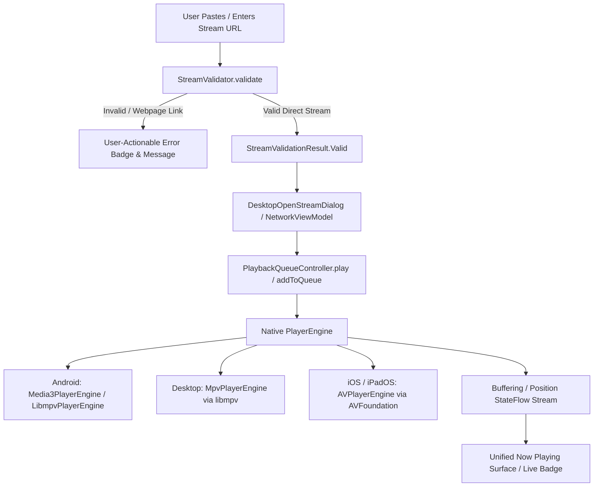

# Universal URL Streaming Architecture (Milestones 53 & 54)

Vimivo supports direct, user-provided audio and video network playback while strictly preserving its offline-first identity. Vimivo is **not** an online media catalog, cloud streaming subscription service, or web scraper.

---

## 1. Architectural Philosophy and Product Boundaries

- **User-Supplied URLs Only**: Playback initiates exclusively when a user enters or pastes a supported stream address.
- **Authoritative Single State Engine**: Network streams use the identical domain `PlayerEngine` contract and `PlaybackQueueController` state machine as local files. No secondary player instances or shadow queues exist.
- **Decoupled Validation Pipeline**: Streams pass through `StreamValidator` before engine invocation, distinguishing direct media resources from generic webpages.
- **Privacy-First**: No remote media catalog API calls, no analytics telemetry, no URL scraping, and no centralized logging of playback destinations.

---

## 2. Core Architecture Pipeline

---

## 3. Native Engine Integrations

### Android (`androidApp`)
- Primary Engine: `Media3PlayerEngine` (Media3 ExoPlayer).
- Module Support: `media3-exoplayer-hls`, `media3-exoplayer-dash`, `media3-exoplayer-rtsp`.
- Secondary Engine: `LibmpvPlayerEngine` for specialized hardware or non-standard container fallback.
- Background Audio: Unified `MediaSession` integration with system notification media controls.

### Desktop (`desktopApp` — macOS, Windows, Linux)
- Native Engine: `MpvPlayerEngine` interfacing with `libmpv` through JNA bindings.
- Transport Hardening: `network-timeout=15`, `tls-verify=yes`, and neutral `user-agent` header.
- Buffering Detection: Real-time query of `paused-for-cache` flag and `demuxer-cache-time` property.
- Video Surface: Embedded Swing `Canvas` bound directly to native OpenGL/Cocoa/Direct3D surfaces.

### iOS / iPadOS
- Native Engine: AVFoundation `AVPlayer` with native HLS manifest support.
- Security Policy: Strict App Transport Security (ATS) enforcement requiring TLS.

---

## 4. Authoritative Queue Integration

1. A network stream is wrapped in a standard `MediaItem` with:
   - `kind = MediaKind.STREAM`
   - `source = MediaSource.NETWORK`
   - `mimeType` inferred or classified by protocol.
2. Queue behavior:
   - **Play Now**: Cancels previous stream cleanly and begins buffered preparation.
   - **Add to Queue**: Appends to the queue without interrupting active playback.
   - **Live Broadcasts**: When duration is unbounded (`null`), seeking is disabled and a `[LIVE]` badge is rendered.
